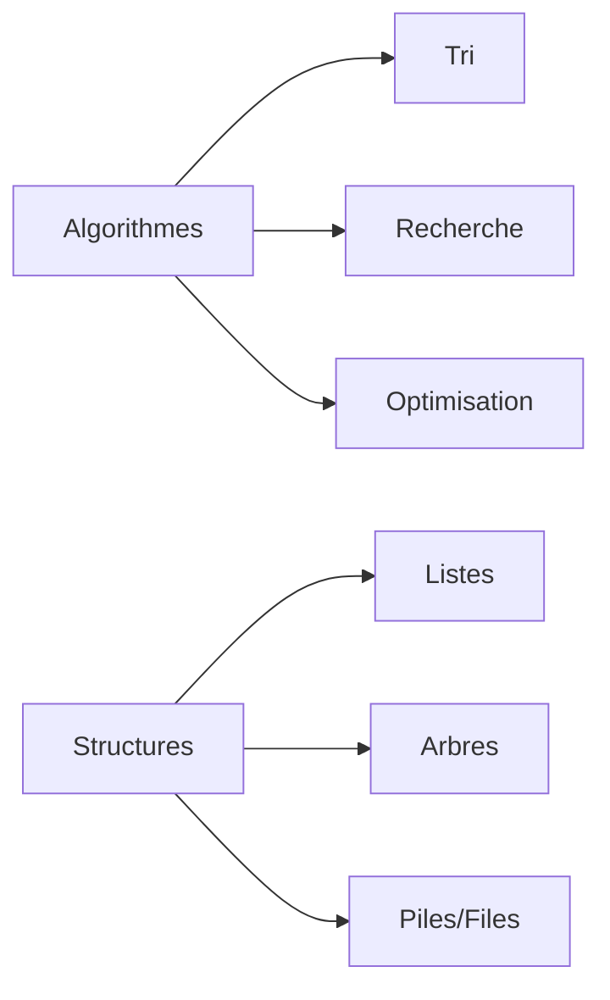

<h1 align="center">
    
</h1>

<h3 align="center"><u>Un développeur, poussé par la curiosité de comprendre les rouages d'un outil qui façonne notre avenir.</u></h3>

    

        🟢 Ouvert aux opportunités · 📍 Genève, Suisse 
        💼 Technico-commercial IT : cinq ans de vente informatique auprès de PME romandes 
        🎓 École 42, Common Core validé en 2024 
        💡 Citation favorite: <em>"La meilleure façon d'obtenir la bonne réponse sur Internet n'est pas de poser une question, mais de poster la mauvaise réponse."</em> - Loi de Ward Cunningham
    

    
    
    

    

<h2 align="center"><u>🎯 Compétences Techniques (Hard Skills)</u></h2>

    

<h3 align="center"><u>💼 Commercial B2B IT</u></h3>

    
<strong>Comptes</strong> : gestion et suivi de comptes PME

    
<strong>Offres</strong> : élaboration et rédaction d'offres, conseil en solutions et services IT

    
<strong>Outils</strong> : HaloPSA (CRM), StreamOne Ion, Microsoft NCE, Microsoft 365

<h3 align="center"><u>🖥️ Infrastructure & Services managés</u></h3>

    
<strong>Support</strong> : niveau 1, suivi et résolution d'incidents, gestion de parc

    
<strong>Systèmes</strong> : Windows, Linux, macOS, VirtualBox, VMware vSphere, Hyper-V

    
<strong>Réseau et sécurité</strong> : Fortinet, Cisco Meraki, Ubiquiti UniFi, Citrix

    
<strong>Coordination</strong> : projets d'infrastructure, documentation technique, GLPI

<h3 align="center"><u>💻 Programmation</u></h3>

<table>
    <tr>
        <td>
            
             Maîtrise approfondie des fondamentaux
        </td>
        <td>
            
             POO et concepts avancés
        </td>
        <td>
            
            
             Scripting et automatisation
        </td>
    </tr>
</table>

<h3 align="center"><u>🖥️ Systèmes et Réseaux</u></h3>

    
<strong>OS</strong> : expertise UNIX/Linux

    
<strong>Process</strong> : gestion avancée des processus et multithreading

    
<strong>Memory</strong> : programmation bas niveau et gestion mémoire

    
<strong>Network</strong> : architecture TCP/IP, protocoles réseau

    
<strong>Signals</strong> : communication inter-processus UNIX

<h3 align="center"><u>🧮 Algorithmes et Structures de Données</u></h3>

Analyse de complexité (Big O)

Optimisation des performances

Implémentation de structures personnalisées

<h3 align="center"><u>🛠️ Développement de Logiciels</u></h3>

    
<strong>Bibliothèques</strong> : création et maintenance (libft)

    
<strong>Systèmes</strong> : shell UNIX, serveurs web

    
<strong>Games</strong> : moteurs 2D/3D, ray-casting

    
<strong>Architecture</strong> : design patterns et bonnes pratiques

<h3 align="center"><u>⚙️ Outils et Environnements</u></h3>

    
    
    
    
    

<h2 align="center"><u>🛠️ Technologies et Outils</u></h2>

    

<h2 align="center"><u>📚 Parcours 42 - Progression</u></h2>

<table align="center">
    <tr>
        <th>Projet</th>
        <th>Description</th>
        <th>Status</th>
    </tr>
    <tr>
        <td><a href="https://github.com/Arcadiastyx/42-Piscine">Piscine</a></td>
        <td>Introduction intensive à la programmation</td>
        <td>✅</td>
    </tr>
    <tr>
        <td><a href="https://github.com/Arcadiastyx/Libft">Libft</a></td>
        <td>Création de sa propre bibliothèque C</td>
        <td>✅</td>
    </tr>
    <tr>
        <td><a href="https://github.com/Arcadiastyx/Printf">Printf</a></td>
        <td>Recréation de la fonction printf</td>
        <td>✅</td>
    </tr>
    <tr>
        <td><a href="https://github.com/Arcadiastyx/Get_next_line">Get Next Line</a></td>
        <td>Lecture de fichier ligne par ligne</td>
        <td>✅</td>
    </tr>
    <tr>
        <td><a href="https://github.com/Arcadiastyx/so_long-2d-game">So Long</a></td>
        <td>Création d'un jeu 2D simple</td>
        <td>✅</td>
    </tr>
    <tr>
        <td><a href="https://github.com/Arcadiastyx/Mini-Talk">Minitalk</a></td>
        <td>Communication entre processus via signaux UNIX</td>
        <td>✅</td>
    </tr>
    <tr>
        <td><a href="https://github.com/Arcadiastyx/Push_Swap">Push Swap</a></td>
        <td>Algorithme de tri avec deux piles</td>
        <td>✅</td>
    </tr>
    <tr>
        <td>Cub3D</td>
        <td>Moteur de ray-casting style Doom</td>
        <td>✅</td>
    </tr>
    <tr>
        <td><a href="https://github.com/Arcadiastyx/Philosopher">Philosophers</a></td>
        <td>Problème des philosophes (threads)</td>
        <td>✅</td>
    </tr>
    <tr>
        <td>Minishell</td>
        <td>Création d'un shell basique</td>
        <td>✅</td>
    </tr>
    <tr>
        <td><a href="https://github.com/Arcadiastyx/CPP_module">CPP Modules</a></td>
        <td>Introduction à C++</td>
        <td>✅</td>
    </tr>
    <tr>
        <td><a href="https://github.com/42-Student-Teams/ft_irc">ft_irc</a></td>
        <td>Serveur IRC (Internet Relay Chat)</td>
        <td>✅</td>
    </tr>
    <tr>
        <td><a href="https://github.com/42-Student-Teams/ft_transcendence">ft_transcendence</a></td>
        <td>Introduction au développement web full stack</td>
        <td>✅</td>
    </tr>
</table>

<h3 align="center"><u>Légende</u></h3>

✅ Terminé

🔄 En cours

📝 À venir

<h2 align="center"><u>🚀 Réalisations</u></h2>

- **[Clefs des Sols](https://taupe-biscochitos-7452f5.netlify.app/)** : site vitrine pour une entreprise de paysagisme écologique
- **[L'Arcade-Hêtre](https://dapper-pegasus-384f16.netlify.app/)** : site d'un cabinet de bien-être avec scène 3D d'accueil (préversion)
- **[Ce portfolio](https://isaac-naranjo.com/)** : conçu comme un projet client, de la direction artistique au déploiement continu

<h2 align="center"><u>🎓 Formation</u></h2>

- **École 42, Lausanne** : Common Core validé en 2024 (C, C++, algorithmique, systèmes, réseau)
- **École Hôtelière de Genève** : hôtelier-restaurateur diplômé ES

Projets système en C et C++ : [github.com/Arcadiastyx](https://github.com/Arcadiastyx)

<h2 align="center"><u>🌐 Solutions Web</u></h2>

<table align="center">
    <tr>
        <th>Catégorie</th>
        <th>Technologies</th>
        <th>Projets</th>
        <th>Description</th>
    </tr>
    <tr>
        <td>Frontend</td>
        <td>
            
            
            
        </td>
        <td><a href="https://isaac-naranjo.com/">Portfolio Personnel</a></td>
        <td>Site web personnel présentant mes projets et compétences</td>
    </tr>
    <tr>
        <td>Sites clients</td>
        <td>
            
            
            
        </td>
        <td><a href="https://taupe-biscochitos-7452f5.netlify.app/">Clefs des Sols</a>, <a href="https://dapper-pegasus-384f16.netlify.app/">L'Arcade-Hêtre</a></td>
        <td>Sites vitrines réalisés pour des clients</td>
    </tr>
    <tr>
        <td>Backend</td>
        <td>
            
        </td>
        <td>API REST</td>
        <td>Conception d'API RESTful</td>
    </tr>
    <tr>
        <td>DevOps</td>
        <td>
            
            
        </td>
        <td>Déploiement continu</td>
        <td>Configuration et déploiement d'applications</td>
    </tr>
</table>

<h2 align="center"><u>🗣️ Langues</u></h2>

    
Français et espagnol (natifs) · Anglais (B2)

